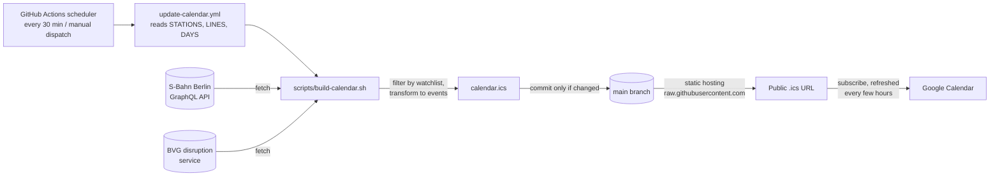

# Berlin ÖPNV Disruptions Calendar

Builds an iCalendar feed of public transport (ÖPNV) disruptions in Berlin for the stations and lines you care about, covering S-Bahn Berlin and BVG (bus, tram, U-Bahn), so you can subscribe to it in Google Calendar.

## How it works



1. **Scheduler:** a GitHub Actions workflow runs every 30 minutes (or on manual dispatch).
2. **Fetch:** the script queries only the operators the watchlist needs (S-Bahn Berlin, BVG). If any query fails, the run fails and the existing feed is kept.
3. **Transform:** consequences touching a watched station or line and overlapping the horizon become iCalendar events (see [Events](#events)).
4. **Commit:** the workflow commits `calendar.ics` to `main` only when it changed.
5. **Static hosting:** the file is served as-is from GitHub (`raw.githubusercontent.com`); there is no server.
6. **Google Calendar:** subscribes to that URL and polls it on its own schedule.

## Data source

Disruptions come from two operators:

- **S-Bahn Berlin:** the GraphQL API behind the [S-Bahn Berlin](https://sbahn.berlin/) website (`https://api.sbahn.berlin/construction-api/query`).
- **BVG:** the disruption service behind [bvg.de](https://www.bvg.de/) (`https://www.bvg.de/disruption-reports-service/disruptions/v1/de`).

Both are unofficial, undocumented APIs discovered via the browser's network tab, so they may change without notice.

Without `--input-sbahn-berlin` the script queries the live API (`--api-url-sbahn-berlin` overrides the endpoint). `--input-sbahn-berlin <file>` reads a saved response instead, which the tests use. BVG lines (bus, tram, U-Bahn) work the same way with `--api-url-bvg` and `--input-bvg`. An operator is only queried if the watchlist needs it; if any queried operator fails, the whole run fails and the existing feed is kept.

## Use it for your own stations and lines

The watchlist is hardcoded in the workflow, so make it yours by forking:

1. **Fork** this repository on GitHub. Keep it **public**, otherwise the raw URL below needs authentication and Google Calendar can't read it.
2. **Edit the watchlist** in [`.github/workflows/update-calendar.yml`](.github/workflows/update-calendar.yml):

   ```yaml
   env:
     STATIONS: "Schöneweide,Westkreuz" # S-Bahn stations, comma-separated
     LINES: "S9,U2,Tram M10,Bus 160"   # line labels, comma-separated
     DAYS: "14"                        # horizon in days, 1 to 14
   ```

   - Stations are S-Bahn only and matched by name (no `S ` prefix needed). Lines use labels like `S9`, `U2`, `Tram M10`, `Bus 160`. At least one station or line is required; the lists are combined (union).
   - Try your values locally first (see [Usage](#usage)): the script reports unknown or ambiguous names and lists suggestions.
3. **Enable Actions** in the fork's *Actions* tab (scheduled workflows are off in forks by default). Under *Settings → Actions → General → Workflow permissions* choose *Read and write permissions* so the workflow can push `calendar.ics`.
4. **Run it once:** *Actions → Update calendar → Run workflow*. After that it runs every 30 minutes. Adjust the `cron` line in the workflow to change the frequency.
5. **Subscribe** in Google Calendar (*Other calendars → From URL*) with your own URL:

   ```
   https://raw.githubusercontent.com/<your-user>/<your-repo>/main/calendar.ics
   ```

   Google refreshes subscribed calendars only every several hours, so updates are not instant. Other calendar apps that support `.ics` subscriptions work too.

Don't edit `calendar.ics` by hand; the workflow overwrites it. Using a different branch than `main` means changing the branch in the URL.

## Subscribing in Google Calendar

For the original feed, choose *Other calendars → From URL* and paste:

```
https://raw.githubusercontent.com/marcobiedermann/sbahn-berlin-disruptions/main/calendar.ics
```

## Run locally

```bash
scripts/build-calendar.sh --output /tmp/feed.ics --station Schöneweide --line "Bus 160"
```

This queries the live APIs and writes the feed to `/tmp/feed.ics`; import it into any calendar app to inspect it. To work offline, use the bundled fixture (see [Usage](#usage)).

## Requirements

`bash`, `curl` and `jq` to run the script. `perl` and [`shellcheck`](https://www.shellcheck.net/) (e.g. `brew install shellcheck`) and `python3` for the tests. Nothing else.

## Usage

```bash
scripts/build-calendar.sh --output <feed.ics> [--station <name> ...] [--line <label> ...] [--days <n>] [--now <timestamp>] [--input-sbahn-berlin <api-response.json>] [--input-bvg <bvg-response.json>] [--api-url-sbahn-berlin <url>] [--api-url-bvg <url>]
```

| Flag        | Description                                                                    | Example                                    |
| ----------- | ------------------------------------------------------------------------------ | ------------------------------------------ |
| `--input-sbahn-berlin`| Saved API response (JSON); if omitted, the live API is queried                 | `--input-sbahn-berlin tests/fixtures/api-response.json` |
| `--api-url-sbahn-berlin`| GraphQL endpoint to query when `--input-sbahn-berlin` is absent                             | `--api-url-sbahn-berlin https://api.sbahn.berlin/construction-api/query` |
| `--output`  | Path of the `.ics` feed to write (required)                                    | `--output calendar.ics`                    |
| `--station` | Station name; repeatable. At least one `--station` or `--line` is required     | `--station Schöneweide --station Westkreuz` |
| `--input-bvg` | Saved BVG response (JSON); if omitted, the live BVG API is queried | `--input-bvg tests/fixtures/bvg-response.json` |
| `--api-url-bvg` | BVG endpoint to query when `--input-bvg` is absent | `--api-url-bvg https://www.bvg.de/disruption-reports-service/disruptions/v1/de` |
| `--line`    | Line label, case-insensitive; repeatable. `S9` (S-Bahn), `U2` (U-Bahn), `"Tram M10"`, `"Bus 160"` | `--line S9 --line "Bus 160" --line "Bus 163"` |
| `--days`    | Horizon length in days from now (1 to 14, default `14`)                                 | `--days 7`                                 |
| `--now`     | UTC timestamp to use as "now" (default: current time), for reproducible runs   | `--now 2026-10-22T12:00:00Z`               |

A consequence is included if it affects any given station or any given line (union, each consequence appears once). Pass several stations or lines by repeating the flag.

Stations are resolved by name, so you never need internal IDs. Matching ignores case and the `S `/`S+U `/`U ` prefix: `Schöneweide` matches `S Schöneweide` but not `S Schöneweide Betriebsbahnhof`. Lines match exactly. Only events overlapping the horizon (`--now` up to `--now` + `--days`) are written; an event that overlaps is kept in full, everything else is dropped. Unknown or ambiguous stations, unknown lines, invalid arguments, malformed input and API error responses make the script exit non-zero with a message (suggestions or the list of known lines where useful); the existing output file is never overwritten on failure.

Example using the bundled fixture:

```bash
scripts/build-calendar.sh --input-sbahn-berlin tests/fixtures/api-response.json --output /tmp/feed.ics --station Schöneweide --line S9
```

## Events

- A continuous period becomes one event; a daily repeating period (e.g. "täglich 08:00 - 16:00") becomes one event per day. Overnight windows (22:00 - 01:30) end on the following day.
- Times are Europe/Berlin local time (`TZID`), so daily windows keep their wall-clock time across the daylight saving change. The script sets `TZ` itself; your machine's time zone doesn't matter.
- Summary: `S9 · Schöneweide ⇄ Flughafen BER · Ersatzverkehr`. The description has the period, lines, affected stations, a link to the consequence's detail page (S-Bahn Berlin only, omitted if the API gives no task), line links and the last update. Events are marked as free.

## Tests

```bash
tests/run.sh
```

CI runs shellcheck and the tests on pull requests.

The tests call the script through its command line with `tests/fixtures/api-response.json` and compare the output to the files in `tests/golden/` (after undoing line folding), and also check line length, CRLF endings, deterministic output and error handling.


BVG disruptions without an end date become an all-day event on their start day. Only the BVG type `TRAFFIC` is used (elevator messages are ignored). Stations are S-Bahn only.
